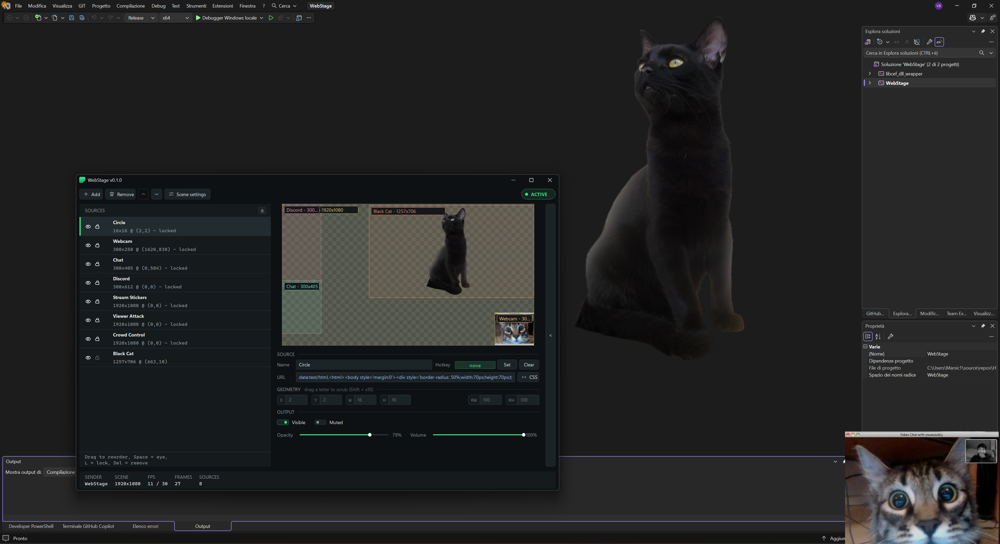

# Spout2OverlayHUD

🎯 **Spout2OverlayHUD** is a Windows application that displays a Spout2 sender signal as a HUD overlay, with direct access to OpenGL textures. Perfect for integrating OBS scenes and sources directly on your screen!



---

## ✨ Features

✅ **Low latency**: The signal is rendered as an OpenGL texture with minimal performance impact.  
✅ **Clickthrough window**: Does not interfere with user input.  
✅ **Smooth Mode** *(new in 1.0)*: Refreshes at twice the monitor rate so no sender frame is skipped, even when sender and monitor refresh are not aligned. Toggleable from the tray menu.  
✅ **True pause**: Pausing hides the overlay and idles the app (near-zero CPU/GPU) while tray menu and hotkeys stay responsive.  
✅ **Multi-monitor support** *(new in 1.0)*: Screen selector with real monitor names and resolutions, remembered size/position per screen, automatic fit-to-screen on first select.  
✅ **Global hotkeys** *(new in 1.0)*: Optional hotkeys for pause/resume and screen switching, configurable from the tray menu (none set by default).  
✅ **Dark tray menu** *(new in 1.0)*: Dark themed menu with rounded corners and descriptions on hover.  
✅ **Status tray icon** *(new in 1.0)*: Shows pause bars over the icon when paused or no sender is detected.  
✅ **Sender pinning** *(new in 1.0)*: Stays on the selected sender; if it closes the overlay waits for it instead of jumping to another sender. Automatic reconnection when it returns.  
✅ **Idle mode** *(new in 1.0)*: Drops to a low refresh rate when no sender is present to save resources.  
✅ **Versatile usage**: Ideal for streamers with a single monitor, allowing real-time display of effects, chat, and interactive overlays (Crowd Control, Stream Stickers, Viewer Attack) directly in the game.

📺 **Example usage**: Use OBS to overlay webcams, browsers, monitors—the possibilities are endless! For a lighter sender without OBS, try [WebStage](https://github.com/Marsic1/WebStage).

---

## 🛠️ Technologies Used

🔹 **[OpenFrameworks](https://openframeworks.cc/)**: For window management *(Version 13 - 20260731 release used for 1.0 compilation)*  
🔹 **[Spout2 SDK](https://spout.zeal.co/)**: For Spout2 signal management and rendering  

---

## 🚀 Installation & Compilation Guide

1️⃣ **Download and unpack** OpenFrameworks (13+)  
2️⃣ **Download and unpack** SpoutGL folder (from SpoutGL SDK git) inside the `apps` folder of OpenFrameworks  
3️⃣ **Download and unpack** this repository inside the `SpoutGL` folder  

Your folder structure should look like this:

```
OpenFrameworks/
 ├── apps/
 │   ├── SpoutGL/
 │   │   ├── Spout2OverlayHUD/
 │   │   │   ├── Spout2OverlayHUD.sln
```

4️⃣ **Open `Spout2OverlayHUD.sln` with Visual Studio 2022**  
5️⃣ **Rebuild everything** and run the project! 🚀

---

## 🔗 Recommended Projects

Enhance your streaming experience by using these tools alongside Spout2OverlayHUD:

- 🎥 [VDO.Ninja](https://vdo.ninja/) - Webcam overlay toggleable via Stream Deck or hotkeys  
- 💬 [Social Stream Ninja](https://socialstream.ninja/) - Customizable chat overlay for any platform  
- 🎭 [Stream Stickers](https://streamstickers.com/) - Interactive stickers overlay  
- 🎮 [Viewer Attack](https://www.viewerattack.com/) - Real-time throwable stickers and effects  
- 🕹️ [Crowd Control](https://crowdcontrol.live/) - Viewer-controlled game interactions  
- 🖥️ [WebStage](https://github.com/Marsic1/WebStage) - Lightweight OBS alternative: composites HTTP overlays and sends them via Spout2, made to pair with this HUD  

---

## ❤️ Support the Project

If you find Spout2OverlayHUD useful, consider supporting me with a donation! 🚀 Every contribution helps improve and maintain the project.

[](https://ko-fi.com/marsic1)

Thank you for your support! ✨
